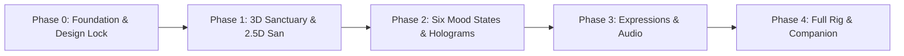

# San — A Little Place for You

> *At 2 AM, rain traces the window of San’s compact bedroom while a luminous city drops away behind her; she turns toward the user, the room responds to their chosen mood, and every interface element feels like it belongs to her world.*

A cinematic, interactive 3D companion website that provides a quiet, aesthetic sanctuary within a vast neon metropolis. Built on a hybrid architecture combining real-time 3D environments with crisp, accessible semantic HTML.

---

## 🌌 Project Overview

**San — A Little Place for You** is an interactive web experience designed to feel intimate, grounding, and emotionally resonant. Unlike generic AI dashboards or chatbot interfaces, San is a single recognizable protagonist in a living, breathing spatial world.

### Key Creative Pillars

1. **Cinematic Cyberpunk Metropolis:** Deep vertical skyline, wet reflective streets, distant holographic signage, cool blue-gray atmosphere, and gentle rain.
2. **Personal Bedroom Sanctuary:** Compact, lived-in space featuring a desk, warm peach lamp, plushie, plant, headphones, and a window overlooking the city.
3. **Recognizable Companion:** San remains consistent in every state—voluminous black hair, thin-framed glasses, expressive eyes, and dark clothing.
4. **Spatial Holographic Interface:** Mood selection cards behave as floating 3D holographic panels inside the room, while accessible HTML carries all interactive copy.
5. **Restrained Audio Sanctuary:** Dreamy, nostalgic, electronic, and melancholic soundtrack—always consent-gated and strictly opt-in.

---

## 🛠️ Technology Stack & Rationale

We selected a modern, highly performant web stack tailored for real-time 3D experiences:

| Technology | Role | Rationale |
|---|---|---|
| **React 19** | Application Framework | Component-based state management, declarative UI, and seamless coordination between 3D scene graphs and DOM layers. |
| **TypeScript** | Type Safety | Strictly typed scene coordinates, mood state contracts, and component props to prevent runtime errors. |
| **Vite** | Build Tool & Dev Server | Ultra-fast Hot Module Replacement (HMR), optimized Rollup bundling, and modern ESM support. |
| **Three.js** | WebGL Rendering Engine | Industry standard WebGL/WebGPU library offering fine-grained control over geometry, shaders, lighting, and GPU memory disposal. |
| **React Three Fiber (R3F)** | React Renderer for Three.js | Declarative scene graph composition, automatic canvas lifecycle management, and clean hooks for render loops. |
| **@react-three/drei** | Three.js Helpers | High-performance utilities for camera controls, asset loaders, HTML DOM projections, and shader helpers. |
| **Vanilla CSS** | Styling System | High-performance styling without heavy runtime CSS abstractions, preserving total aesthetic control. |

### Architectural Approach: Hybrid 3D + Semantic HTML (Approach C)

The 3D canvas renders the bedroom, city skyline, rain particles, and lighting. Text, buttons, mood cards, and dialogs are rendered as semantic HTML elements overlaid and projected from 3D scene anchors. This guarantees:
- **Full Web Accessibility (WCAG AA):** Keyboard tab navigation, high-contrast outlines, screen reader announcements.
- **Flawless Text Rendering:** Native subpixel font rendering and user text selection without WebGL texture blurring.
- **Progressive Enhancement:** If WebGL fails or hardware is low-power, a beautiful fallback poster and semantic DOM remain 100% interactive.

---

## 📁 Repository Structure

```text
san/
├── README.md                      # Project overview, setup, and roadmap
├── DESIGN.md                      # Comprehensive design specification (Manus)
├── LICENSE                        # License terms (Pending author selection)
├── .gitignore                     # Security and artifact exclusions
├── .env.example                   # Safe environment template
├── docs/
│   ├── character-guide.md         # San's visual identity, expressions, and moods
│   ├── asset-sources.md           # Asset inventory, licensing, and ledger
│   └── technical-notes.md         # Spatial layout, rendering budgets, and architecture
├── public/
│   ├── images/                    # Static image assets (.gitkeep)
│   ├── audio/                     # Rights-cleared soundscapes (.gitkeep)
│   └── models/                    # 3D GLB/glTF models (.gitkeep)
├── src/
│   ├── app/                       # Application entry points and state stores
│   ├── components/                # UI overlays, dialogs, and controls
│   ├── scenes/                    # 3D scene graph, lighting, room, and skyline
│   ├── characters/                # San 2.5D/3D presentation components
│   ├── styles/                    # Global design tokens and CSS themes
│   ├── audio/                     # Web Audio controllers and sound managers
│   └── assets/                    # Bundled icons and vectors
└── tests/                         # Unit and integration test suites (.gitkeep)
```

---

## 🚀 Getting Started

### Prerequisites

- **Node.js**: v18.0.0 or higher (v20+ recommended)
- **npm**: v9.0.0 or higher

### Installation

1. Clone or open the repository:
   ```bash
   cd san
   ```

2. Install dependencies:
   ```bash
   npm install
   ```

3. Create your local environment configuration:
   ```bash
   cp .env.example .env
   ```

4. Launch the local development server:
   ```bash
   npm run dev
   ```

5. Open [http://localhost:5173](http://localhost:5173) in your browser.

### Available Scripts

- `npm run dev`: Starts Vite dev server with instant HMR.
- `npm run build`: Type-checks with `tsc` and compiles production bundle to `dist/`.
- `npm run preview`: Previews the production build locally.

---

## 🗺️ Implementation Roadmap

Mapped directly from the `DESIGN.md` blueprint:



### Phase 0: Foundation & Security *(Current)*
- [x] Establish project directory structure and clean Git repository.
- [x] Configure TypeScript, Vite, React 19, and Three.js/R3F dependencies.
- [x] Enforce `.gitignore` security rules (no credentials or unvetted files).
- [x] Populate comprehensive documentation (`README.md`, `character-guide.md`, `asset-sources.md`, `technical-notes.md`).
- [ ] Receive author license selection before granting rights.

### Phase 1: Sanctuary Environment & 2.5D San
- [ ] 3D modular room geometry in Blender (desk, window frame, floor, bed).
- [ ] Instanced low-poly city skyline with emissive window textures.
- [ ] Layered rain system (window droplets, near-camera streaks, distant haze).
- [ ] San 2.5D multi-plane layered character rig (head, hair, eyes, glasses reflection, rim lighting).
- [ ] Lighting setup: cool cyan city key, warm peach desk practical, magenta accent.

### Phase 2: Six Mood States & Spatial Interface
- [ ] Implement the six mood states: **SAD, DRAINED, CHAOTIC, LOCKED IN, HAPPY, OVERTHINKING**.
- [ ] Floating holographic mood cards with 3D depth and anchored semantic HTML buttons.
- [ ] Dynamic camera transitions between opening view, mood selection, and desk focus.
- [ ] Quality preset selector (Ultra, High, Balanced, Low) with capped DPR.

### Phase 3: Expressive Gestures & Audio Sanctuary
- [ ] 12-expression library implementation (Happy, Sad, Drained, Smug, Focused, Sleepy, etc.).
- [ ] Idling gesture loops: blinking, breathing, subtle head tilts.
- [ ] Rights-cleared ambient rain loop and lo-fi soundtrack player.
- [ ] Independent mood vs. speaking style controls (Gentle, Funny, Sarcastic [opt-in], Honest, Adaptive).

### Phase 4: Full 3D Evaluation & Desktop Integration
- [ ] Evaluate full 3D avatar rig (after validating 2.5D character sheet).
- [ ] Architecture design for companion desktop mode (system tray / floating widget).
- [ ] Complete WCAG 2.1 AA accessibility and performance profiling across mobile and desktop devices.

---

## 🔒 Security & Privacy

- **Zero Secret Commits:** Real credentials, API keys, and local environment files are strictly excluded via `.gitignore`.
- **Client-Side Respect:** User preferences (mood, speaking style, quality) remain in local session storage and are never tracked without consent.
- **Consent-First Audio:** Audio never autoplays; playback requires an explicit user gesture.

---

## 📄 License

Currently **Proprietary / All Rights Reserved** pending explicit license selection by the project author. See [LICENSE](file:///c:/san/LICENSE) for details.
