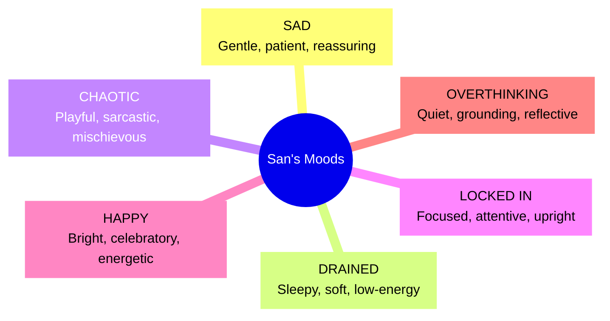

# San — Character Guide & Reference Specification

> *San is a single recognizable protagonist with multiple emotional states, not a directory of AI agents and not a generic chatbot inside a neon dashboard.*

---

## 1. Character Identity & Visual Lock

### 1.1 Core Identity Elements

San's identity must remain immediately identifiable across all mood states, camera angles, and lighting conditions.

| Feature | Lock Specification | Rules & Constraints |
|---|---|---|
| **Name** | San | Always use "San" in copy, labels, and state identifiers. Never refer to moods as separate characters. |
| **Hair** | Long, voluminous black hair | Hair silhouette is the primary recognition cue after the face. Keep near-black with subtle blue-violet rim reflections. Never turn hair fully blue or change hairstyle per mood. |
| **Glasses** | Thin, dark frame | Glasses catch subtle cyan/magenta reflections, but must never become an opaque glowing neon mask. Eye pupils and gaze must remain visible. |
| **Eyes** | Expressive manga-inspired eyes | Clear eyelid, eyebrow, and gaze directions. Catchlights shift based on mood (sparkling in Happy, watery in Sad, narrowed in Focused). |
| **Face Structure** | Manga/anime-inspired | Consistent proportions, cheek contours, and jawline across all states. Do not vary age or ethnicity across moods. |
| **Wardrobe** | Dark, understated clothing | Simple silhouette (e.g., oversized dark hoodie or knit sweater) so scene lighting, not wardrobe swaps, carries emotional variations. |

---

## 2. Character Reference Requirements & Lock Protocol

> [!IMPORTANT]
> **Strict Reference-File Protocol:**  
> The original San character references are external to this repository. This documentation does **not** assume, fabricate, or guess unverified pixels, colors, or line work.  
> Before 3D modeling or 2D layered painting begins, the artist must perform an explicit **Visual Lock Pass** against the author's primary reference artwork.

### Required Lock Deliverables (Phase 1 Gate)
1. **Neutral Turnaround Sheet:** Front, 3/4 view, side profile, seated at desk, and window profile.
2. **Feature Landmark Guide:** Exact hairline landmarks, eye spacing, glasses bridge placement, mouth-width extremes, and hand scale.
3. **Lighting Calibration Pass:** Verifying how San's hair and skin respond to the warm peach desk practical and cool cyan city rim light.

---

## 3. Character Presentation Strategy

### Considered Options & Decisions

| Approach | Strengths | Constraints & Risks | Production Decision |
|---|---|---|---|
| **2.5D Layered Rig** | Highest fidelity to 2D illustration; fast iteration; lightweight on mobile | Constrained camera orbit angle (±15°); requires layered art assets | **Phase 1 Production Target** |
| **Hybrid 3D Room + 2.5D San** | Genuine 3D depth and parallax in environment; flawless character identity | Requires careful rim lighting and contact shadow so she sits naturally in the room | **Primary Baseline** |
| **Fully Rigged 3D San** | 360° orbit, dynamic real-time shadows, seamless camera transitions | High asset authoring cost (modeling, retopology, hair cards, blendshapes) | **Phase 4 Evaluation Gate** |

### 2.5D Layer Stack Breakdown
1. **Background Contact Shadow:** Soft ground ambient occlusion at chair/desk.
2. **Torso & Clothing Layer:** Base seated posture.
3. **Hair (Back):** Occluded strands behind shoulders.
4. **Head & Neck:** Base skin tone.
5. **Facial Features:** Separate blend layers for brows, eyelids, and mouth.
6. **Glasses Frame & Lenses:** Semi-transparent with angled specular reflection map.
7. **Hair (Front & Bangs):** Voluminous front layers with responsive idle sway.
8. **Rim Lighting Overlay:** Additive blend mask catching window cyan and desk peach light.

---

## 4. Emotional Spectrum: The Six Mood States

San embodies six distinct emotional states. Each state influences her pose, expression, the room's lighting grade, and available activities.

### 4.1 State Breakdown

#### 1. SAD
- **Expression & Pose:** Gentle, watery eyes; cheek resting on one hand or holding plushie close; shoulders low; gaze rests toward user during interaction and out the window when idle.
- **Lighting & Atmosphere:** Soft peach light on cheek, quiet rainy window, deep blue shadows, rain slowed to 0.75× speed.
- **Tone & Copy:** Patient, reassuring. *"Hey, you. You don't have to pretend you're okay here."*
- **Activities:** Gentle conversation, comfort journaling, soft lo-fi music, virtual hug.

#### 2. DRAINED
- **Expression & Pose:** Heavy eyelids, relaxed mouth, body sunk into chair/daybed, arms around plushie, soft downward gaze.
- **Lighting & Atmosphere:** Dim, cozy ambient light, very slow rain (0.55× speed), zero sharp UI pulses, elongated transition curves.
- **Tone & Copy:** Low-pressure, accepting. *"Let's make everything a little smaller. One tiny step is enough for now."*
- **Activities:** Sensory decompression, brain dump, breathing pause.

#### 3. CHAOTIC
- **Expression & Pose:** Mischievous smirk, one raised eyebrow, playful side-eye, torso angled forward toward the screen.
- **Lighting & Atmosphere:** Vivid magenta/cyan contrast, energetic rain (1.15× speed), subtle UI glitch accents.
- **Tone & Copy:** Teasing, sarcastic, funny (strictly opt-in). *"Girl. How did we go from opening the assignment to investigating celebrity gossip?"*
- **Activities:** Playful roasts, distraction resets, absurd challenges.

#### 4. LOCKED IN
- **Expression & Pose:** Focused eyes, glasses catching sharp cyan light, upright posture at desk, hand near laptop/timer, task-directed gaze.
- **Lighting & Atmosphere:** Clean cyan task light, muted skyline distractions, rain steady at 0.65× speed.
- **Tone & Copy:** Motivating, focused, clear. *"One task. One timer. Let's get this done together."*
- **Activities:** Pomodoro timer, milestone checklist, distraction blocker.

#### 5. HAPPY
- **Expression & Pose:** Open smile, sparkling catchlights, open shoulders, small celebratory hand lift.
- **Lighting & Atmosphere:** Warm peach key light, lively city reflections, subtle warm sparkle particles.
- **Tone & Copy:** Celebratory, enthusiastic. *"WAIT. YOU ACTUALLY DID IT?! Tell me everything!"*
- **Activities:** Celebrating wins, positive reflection, high-energy soundtrack.

#### 6. OVERTHINKING
- **Expression & Pose:** Thoughtful gaze toward rain-streaked window, slight brow furrow, hand touching temple or journal.
- **Lighting & Atmosphere:** Deep blue-violet palette, atmospheric haze, calm steady rain (0.65× speed).
- **Tone & Copy:** Grounding, nonjudgmental. *"Your brain is trying to solve seventeen things at once. Let's look at just one."*
- **Activities:** Thought disentanglement, guided journaling, grounding exercises.

---

## 5. Twelve Expression Library

San's facial rig must support twelve foundational expressions across the mood matrix:

| Expression | Eyes | Eyebrows | Mouth | Gaze / Posture | Key Lighting Accent |
|---|---|---|---|---|---|
| **Happy** | Open, rounded | Lifted inner corners | Open smile | Direct gaze | Peach key, soft pink rim |
| **Sad** | Lowered lids, watery | Raised inner brows | Small downturned curve | Window gaze / gentle glance | Soft pink on cheek, blue shadows |
| **Drained** | Heavy lids | Neutral / relaxed | Soft relaxed line | Sunk posture, downward gaze | Desaturated cyan-blue |
| **Annoyed** | Narrowed eyes | Asymmetric (one down) | Flat tight line | Slight head turn, side-eye | Restrained magenta rim |
| **Smug** | Half-lidded | One brow raised | Asymmetric smirk | Confident 3° tilt | Cyan key, magenta cheek rim |
| **Worried** | Wide pupils | Raised and drawn together | Slightly parted | Checking user's expression | Cool violet, desaturated |
| **Curious** | Open, alert | One brow arched | Small "o" or soft smile | Leaning forward 2° | Cyan edge, warm practical |
| **Focused** | Level, narrow gaze | Slightly lowered | Firm neutral line | Task-directed, looking at desk | Clean cyan task light |
| **Excited** | Sparkling, wide | High, arched | Open delighted smile | Forward posture, slight bounce | Peach sparkle with cyan edge |
| **Sleepy** | Nearly closed | Relaxed | Barely visible smile | Head dipping toward plushie | Low blue, soft peach lamp |
| **Calm** | Soft, half-open | Neutral | Gentle closed smile | Balanced, breathing slowly | Muted lavender + peach |
| **Comforting** | Warm, receptive | Gently raised inner brows | Reassuring soft smile | Open palms, welcoming posture | Warm peach key light |

---

## 6. Mood and Speaking Style Independence

Mood governs San's visual presence, posture, room atmosphere, and available tools. Speaking style governs her verbal tone. They must remain **independently configurable**.

### Speaking Styles:
1. **Gentle and Comforting:** Warm, validating, low-pressure.
2. **Funny and Playful:** Lighthearted humor, gentle teasing.
3. **Sarcastic and Teasing:** Sarcastic edge, strictly opt-in, never mocking vulnerability or exhaustion.
4. **Honest and Direct:** Practical, clear, no forced cheerfulness.
5. **Adaptive:** Intelligently calibrated to session context with transparent user overrides.
