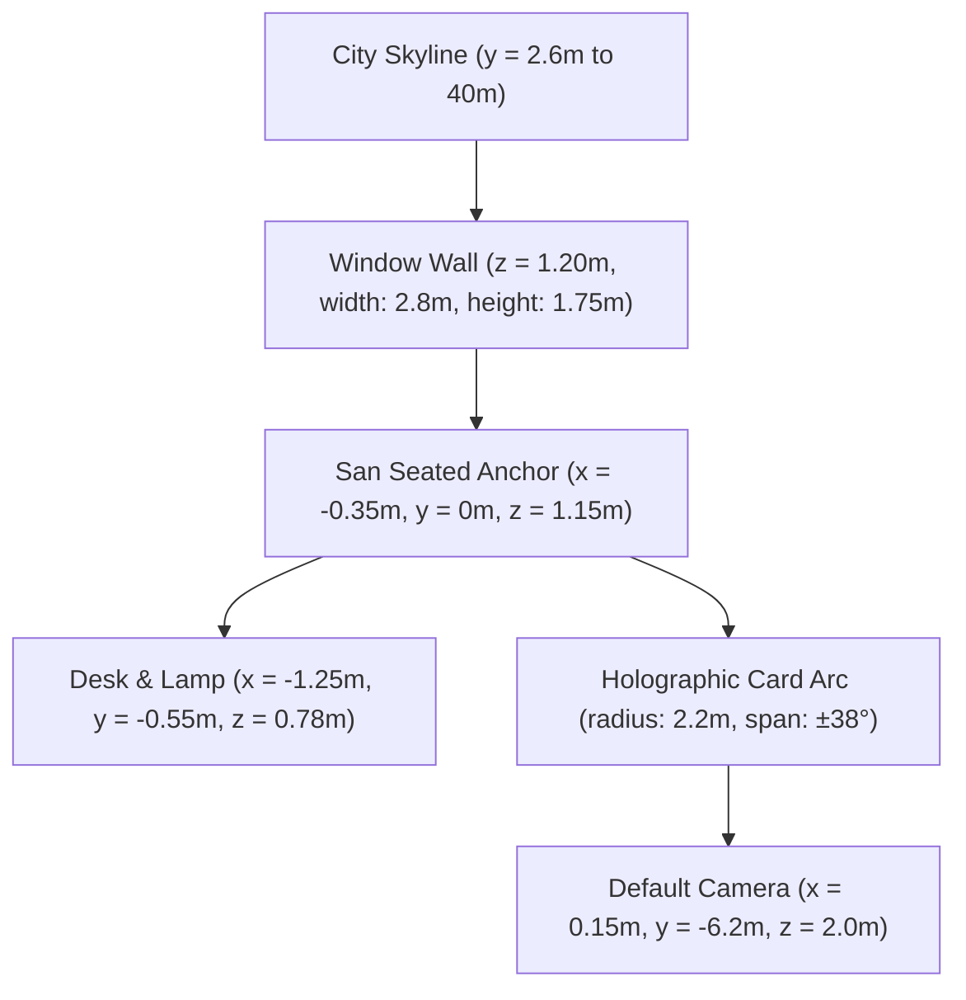

# San — Technical Notes & Architecture Blueprint

> *Implementation Architecture: Hybrid real-time 3D environment with declarative React Three Fiber scene management and accessible, high-contrast semantic HTML overlays.*

---

## 1. Architectural Foundation: Hybrid 3D + Semantic HTML (Approach C)

### Why Approach C?

| Considered Architecture | Strengths | Weaknesses | Decision |
|---|---|---|---|
| **A. Pure Canvas / WebGL (Everything in 3D)** | Total camera integration | Severely compromised accessibility (ARIA), poor text crispness, impossible native text selection, fragile focus states | Rejected |
| **B. 2D Layout with Background Canvas** | Easy standard web development | Disconnected feel; UI sits like a sticker on an unrelated backdrop | Rejected |
| **C. Hybrid 3D Scene + Semantic DOM Overlay** | True spatial depth, 60fps WebGL rendering, native accessible HTML, subpixel text legibility | Requires coordinate synchronization between 3D scene anchors and DOM nodes | **Selected Architecture** |

### Execution Details:
- The `<Canvas />` element sits in the background (`z-index: 0`) and runs the Three.js render loop.
- All interactive controls (mood selectors, volume toggle, quality picker, dialogs) live in a semantic HTML DOM tree (`z-index: 10`).
- Holographic 3D card bodies are rendered in the scene for lighting and parallax depth; corresponding DOM buttons are positioned to match the projected coordinates using `@react-three/drei`'s `<Html />` or CSS anchor projections.

---

## 2. Spatial Coordinate System & Camera Specifications

The scene uses a standard right-handed Cartesian coordinate system with metric units ($1.0 \text{ unit} \approx 1 \text{ metre}$). San’s seated eye-level serves as the central anchor.



### Camera Parameters
- **Type:** Perspective Camera
- **Vertical Field of View (vFOV):** 52° baseline (48–55° responsive range)
- **Near / Far Clipping Planes:** `near = 0.05m`, `far = 150m`
- **Default Position:** `(0.15, -6.2, 2.0)`
- **LookAt Target:** `(0.0, 0.15, 1.45)` (San's eye line at 42–48% of screen height)
- **Parallax Motion:** Subtle 1–2° pointer tracking on desktop; disabled on mobile touch and under `prefers-reduced-motion`.

---

## 3. Lighting Strategy & Shader Budget

To ensure silky 60 FPS performance across modern and mid-range devices, dynamic lights are strictly budgeted:

1. **City / Window Key Light:** Cyan area approximation from window rear-right (`#74E9FF`), intensity 1.0.
2. **Desk Practical Light:** Warm peach point light (`#FFB39A`) at `(-1.2, 0, 1.4)`, intensity 0.7. San's comfort anchor.
3. **Magenta Neon Bounce:** Subtle skyline fill (`#FF4FB3`), intensity 0.25 (active in Neon Night, Chaotic, Happy states).
4. **Soft Ambient Fill:** Deep blue-black hemispheric light (`#0A111E`), intensity 0.2.
5. **Character Rim Highlight:** Shader-driven Fresnel/rim pass rather than an additional dynamic light source.

---

## 4. Performance Tiers & Optimization Strategy

The application detects hardware capabilities on initialization and assigns a performance tier, while always allowing manual user override:

| Feature / Setting | Ultra Tier | High Tier | Balanced Tier *(Default)* | Low / Battery Saver |
|---|---|---|---|---|
| **Target Frame Rate** | 60 FPS | 60 FPS | 45–60 FPS | 30 FPS |
| **Max DPR (Desktop)** | 2.0 | 1.75 | 1.5 | 1.0 |
| **Max DPR (Mobile)** | 1.5 | 1.25 | 1.0 | 1.0 |
| **Rain Particles** | 600 particles | 350 particles | 150 instanced streaks | 30 static/slow streaks |
| **Skyline Complexity** | Full LOD (12 towers) | Med LOD (8 towers) | Low LOD (instanced) | Low LOD (unlit) |
| **Post-Processing** | Bloom + Film Grain | Bloom | Lightweight Bloom | Disabled |
| **Shadow Maps** | Soft PCF shadows | Hard shadows | Baked AO contact maps | Baked AO only |

### Memory & Resource Cleanup
Three.js does not automatically reclaim GPU memory when components unmount. All custom hooks and scene components must implement explicit disposal patterns:
```typescript
// Mandatory disposal pattern in R3F components
useEffect(() => {
  return () => {
    geometry.dispose();
    if (Array.isArray(material)) {
      material.forEach(m => m.dispose());
    } else {
      material.dispose();
    }
    texture?.dispose();
  };
}, [geometry, material, texture]);
```

---

## 5. Progressive Enhancement & Accessibility (WCAG 2.1 AA)

1. **WebGL Detection & Fallbacks:**
   - On initialization, the app tests for WebGL2 support.
   - If WebGL2 is unavailable or context is lost, the canvas falls back to a high-fidelity pre-rendered WebP room poster with CSS parallax.
   - All interactive controls, mood options, and dialogue remain 100% functional.
2. **Reduced Motion (`prefers-reduced-motion`):**
   - Disables all camera dollies and 3D pointer parallax.
   - Replaces 3D camera sweeps with instantaneous or 120ms crossfades.
   - Halts particle movement and dynamic light flickers.
3. **Keyboard & Focus Management:**
   - All interactive elements are native `<button>` or `<a>` elements with standard tab order.
   - High-contrast, non-blurry focus outlines (2px solid `#74E9FF`, 2px offset).
   - Screen reader announcements via `aria-live="polite"` when mood states change.

---

## 6. Audio Architecture (Consent-Gated)

- **Zero Autoplay Policy:** Audio playback strictly requires an explicit user gesture (clicking the in-world player or sound toggle).
- **Web Audio API:** Lo-Fi music and ambient rain loops are managed via a centralized `SoundManager` utilizing Web Audio gain nodes for smooth volume fading and crossfades.
- **Fail-Safe Operation:** If audio fails to load, is blocked by the browser, or is rejected by the user, the application operates normally with complete visual parity.
